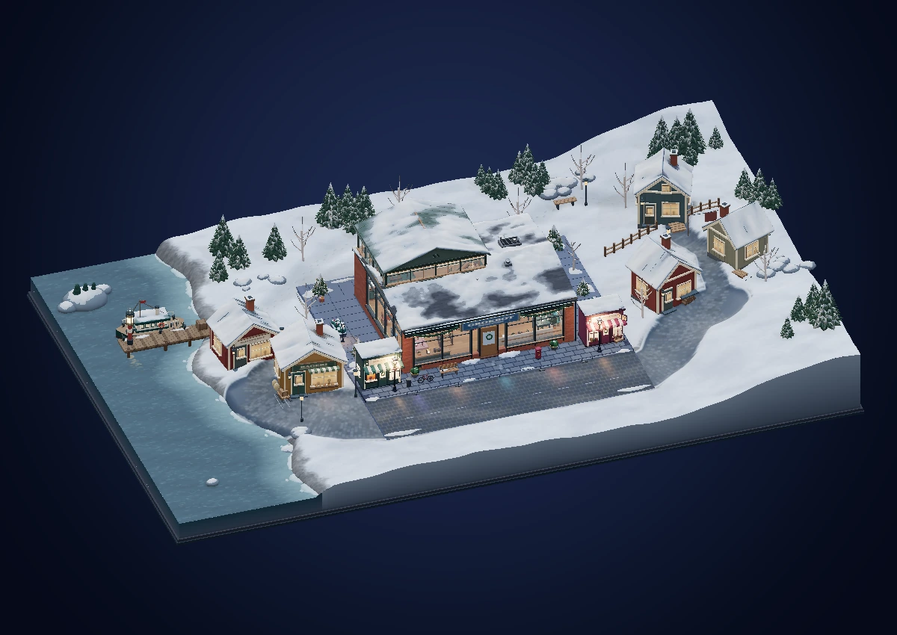

# Grokbot Winter Studio

**可以走近的冬夜工作室 / An interactive winter miniature for your own Grok Bots**

[打开在线展示 · Visit the showcase](https://elysiaivy.github.io/grokbot-winter-studio/) ·
[进入工作室 · Open the studio](https://elysiaivy.github.io/grokbot-winter-studio/studio.html) ·
[下载离线 HTML · Download](https://elysiaivy.github.io/grokbot-winter-studio/#download)

咖啡吧楼上有一间阅览室，可以隔窗望海。在右下角选择「小镇」进入松湾冬港，沿街去面包房、在邮务所盖邮戳，或走到码头回望覆雪的工作室。

## 绑定你自己的 Grok Bot

1. 安装并登录 Grok Bot。在应用里点击 Bot 名称，选择 **Share → Copy link**。如果侧栏菜单提供 **Copy conversation ID**，也可以复制 ID。[Grok Bot 官方说明](https://docs.x.ai/grok-bot/deep-links)
2. 打开工作室，点击 **Grok Bot settings**。把分享链接或 ID 粘贴到对应角色，保存。可以只绑定一个角色。
3. 点击已绑定的机器人，按浏览器提示打开 Grok Bot。点击工位，或按数字键 `1`–`7` 后按 `Enter`，仍可查看特写。

绑定保存在当前浏览器里，可随时清除。下载 `studio.html` 后可以离线看场景。在线版和下载版各自保存设置。启动对话时需要能接收 `grokbot://` 链接的已登录应用。

| 操作 | 方法 |
| --- | --- |
| 转动 / 缩放 | 拖动或方向键 / 滚轮、双指捏合或 `+` 和 `-` |
| 楼层与小镇 | 右下角切换一楼、二楼和小镇，进入小镇后可选观景点 |
| 工位特写 / 回到全景 | 点工位或数字键加 `Enter` / `Esc` |
| 打开已绑定的 Bot | 点机器人或数字键加 `Shift+Enter` |
| 门、树灯、咖啡机 | 点击物体，或按 `D`、`L`、`C` |
| 屋顶 / 暂停角色 / 减少动态 | `T` / 空格 / `R` |

## Use your own Grok Bot

Copy a Bot’s share link from the signed-in Grok Bot app. In the studio, open **Grok Bot settings**, paste it next to a robot, and save. Clicking a bound robot opens the conversation in your installed app. Bindings are saved locally in the browser. Download the standalone HTML to explore the miniature offline.

## 从源码构建 / Build from source

[下载源码 / Download the source](./source.zip)

需要 Node.js 20 或更新版本。运行 `npm ci`、`npm test` 和 `npm run build`。离线版输出到 `dist/standalone.html`。场景由 Three.js 渲染。[第三方许可 / Third-party notices](./THIRD-PARTY-NOTICES.txt)
